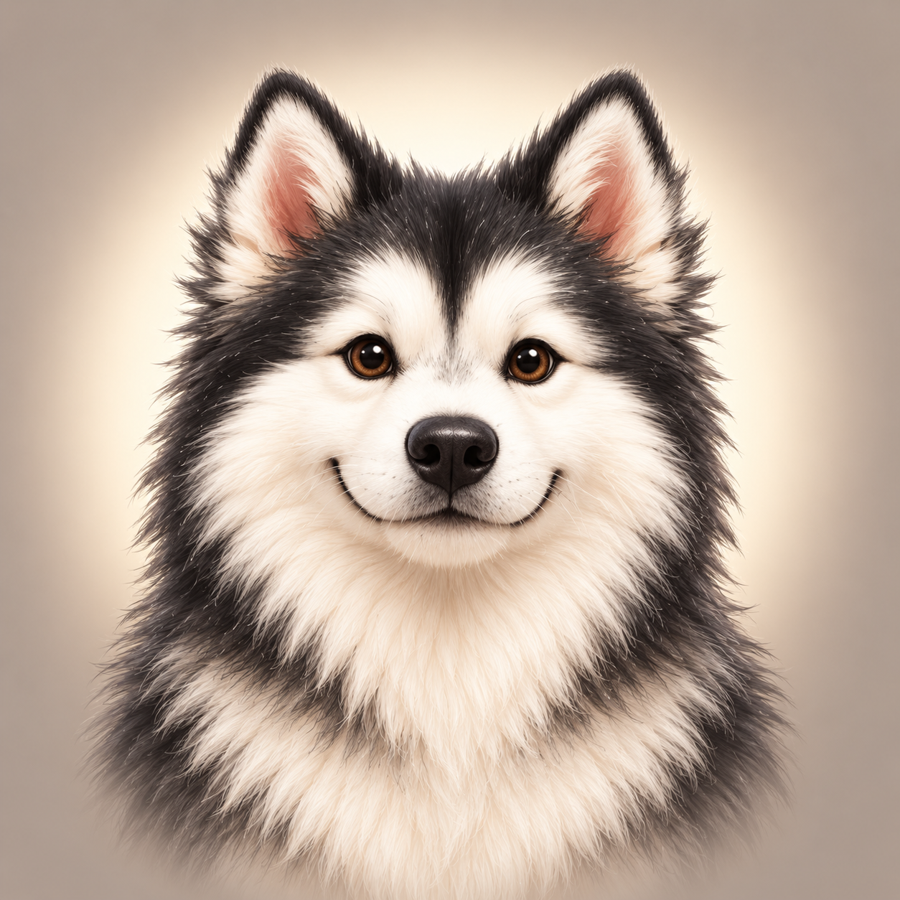
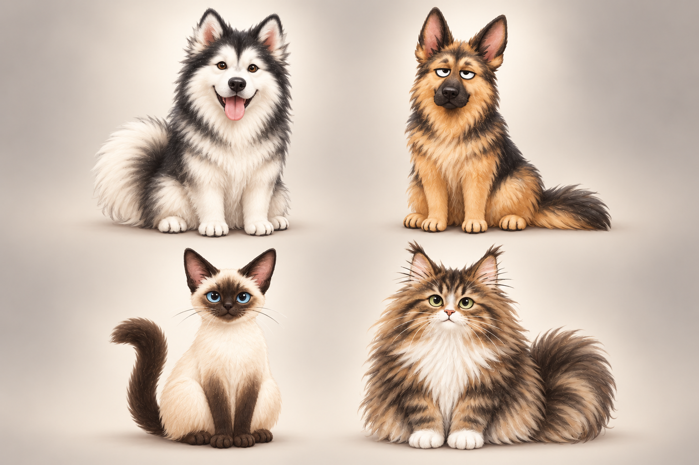

<div align="center">
  
  <h1>Desktop Pet · 桌面宠物</h1>
  <p>一只安静待在桌面上的毛茸茸伙伴，也是一款轻量的喝水与待办提醒工具。</p>
  <p><sub>A lightweight, local-first desktop companion for Windows.</sub></p>

  <p>
    <a href="https://github.com/baichenliu1/desktop-pet/releases/latest"><strong>下载最新版本</strong></a>
    ·
    <a href="#功能亮点">功能</a>
    ·
    <a href="#本地开发">开发</a>
  </p>

  <p>
    
    
    
    
  </p>
</div>

<p align="center">
  
</p>

## 为什么是 Desktop Pet？

Desktop Pet 把提醒做成桌面上的轻互动，而不是又一个需要频繁打开的效率软件。宠物会待机、回应触摸、跟随拖动方向奔跑，并在喝水或待办到期时用动画和气泡提醒你。所有设置和待办数据都保存在本机，不需要账号，也没有遥测或云端同步。

## 功能亮点

| 桌面陪伴 | 健康提醒 | 轻量待办 |
| --- | --- | --- |
| 阿拉斯加、德国牧羊犬、暹罗猫、缅因猫四种形象 | 根据每日目标、工作时段和提醒间隔动态计算每次建议饮水量 | 独立 Todo 窗口，支持添加、完成、删除和普通/重要/紧急优先级 |
| 待机、触摸、拖动奔跑、喝水、喂食、提醒等逐帧动画 | 支持健康指南估算或自定义饮水目标 | 到期后由宠物动画和常驻气泡提醒，确认后消失 |
| 记住位置、多屏适配、100–220px 尺寸调节 | 支持间隔提醒和固定时间提醒 | 紧凑无边框界面，可在桌宠附近滑出 |

此外还支持：

- 无边框透明窗口、始终置顶开关和系统托盘
- 开机自启（默认关闭）
- 简体中文 / English 界面
- 减少动画选项
- 本地持久化，无账号、无广告、无音效

## 下载与运行

前往 [Releases](https://github.com/baichenliu1/desktop-pet/releases/latest) 下载 Windows x64 版本。

| 版本 | 适合场景 | 使用方式 |
| --- | --- | --- |
| `desktop-pet-v0.0.1-windows-x64-setup.exe` | 日常使用，推荐 | 运行安装程序，之后可从开始菜单启动 |
| `desktop-pet-v0.0.1-windows-x64-portable.zip` | 不想安装或希望随身携带 | 解压后运行 `Desktop-Pet.exe`，请勿直接在 ZIP 内启动 |

系统要求：Windows 10/11 x64、Microsoft Edge WebView2 Runtime。多数 Windows 10/11 设备已经预装 WebView2。当前版本未进行商业代码签名，Windows SmartScreen 可能显示未知发布者提示。

### 基本操作

- 拖动宠物：按住宠物移动；向左或向右拖动时会切换奔跑方向。
- 快捷互动：悬停宠物后选择喝水、喂食、待办或设置。
- 退出程序：右键宠物或系统托盘图标，选择“退出”。
- 调整大小：在设置中将宠物尺寸调整为 100–220px。

## 数据与隐私

- 应用不发送遥测，不依赖在线账户，运行时不请求业务网络服务。
- 便携版会优先把数据写入程序旁的 `.desktop-pet-data` 目录。
- 当程序目录不可写时，数据会回退到当前用户的 `AppData` 目录。
- 删除应用前，如需保留待办和设置，请先备份对应数据目录。

## 技术栈

- [Tauri 2](https://tauri.app/)：窗口、托盘、通知和桌面集成
- Rust：原生生命周期、窗口定位和系统能力
- TypeScript + Vite：交互、状态与多语言界面
- Canvas 精灵播放器：逐帧动画、混合过渡和边缘清理

## 本地开发

需要 Node.js、Rust/Cargo、WebView2，以及 Tauri 2 的 Windows 构建环境。

```powershell
npm install
npm run tauri:dev
```

常用检查与构建命令：

```powershell
npm run test:ui
npm run test:sprites
npm run build
$env:CARGO_BUILD_JOBS = "1"
npm run tauri:build
```

项目结构：

```text
src/                 TypeScript UI、提醒逻辑与动画播放器
src/assets/pets/     四只宠物的透明精灵图资源
src/i18n/            Web UI 多语言字典
src-tauri/           Rust/Tauri 桌面端入口与配置
tests/               UI 与行为契约测试
docs/                动画资源和皮肤协议设计文档
```

动画资源规范见 [`docs/animation-asset-pipeline.md`](docs/animation-asset-pipeline.md)，外部皮肤协议草案见 [`docs/pet-skin-format.md`](docs/pet-skin-format.md)。

## 路线图

- 外部 `.pet-skin` 皮肤导入与预览
- 更丰富的宠物动作、过渡和个性化行为
- 提醒历史与更细致的饮水统计
- 更多语言与无障碍优化

## 反馈与贡献

欢迎通过 [Issues](https://github.com/baichenliu1/desktop-pet/issues) 报告问题、提出功能建议或讨论新的宠物动作。提交代码前，请确保 UI 测试和精灵图对齐检查通过。

> 当前仓库尚未声明开源许可证。公开源代码不等于自动授予复制、修改或再分发权利。
